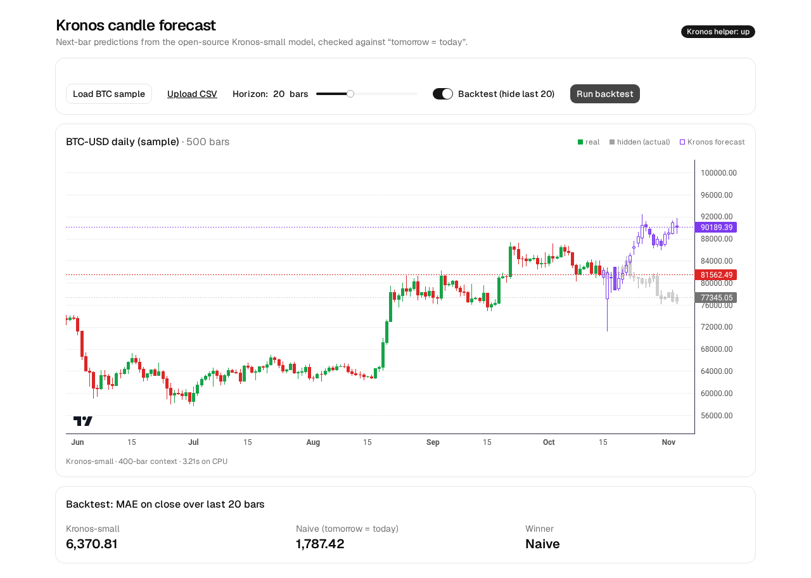

# Kronos candle forecast

Load candlestick (OHLCV) data, ask [Kronos-small](https://github.com/shiyu-coder/Kronos) (MIT) for the next N bars, and backtest it against the naive “tomorrow = today” baseline.



## Run

Needs Bun, [uv](https://docs.astral.sh/uv/), git, and ~1 GB disk for CPU PyTorch.

```bash
./start.sh          # first run: creates server/.venv, clones Kronos, installs deps; then starts helper (:8000) + web app (:5173)
```

Or separately:

```bash
./server/setup.sh
(cd server && .venv/bin/uvicorn app:app --port 8000)   # Kronos helper (downloads model weights from Hugging Face on first start)
bun install && bun run dev                              # web app on http://localhost:5173, proxies /api -> :8000
```

## What it does
- **Load BTC sample** or **Upload CSV** (`timestamps|date, open, high, low, close[, volume]`).
- **Forecast**: the helper calls `KronosPredictor.predict` with `NeoQuasar/Kronos-small` + `NeoQuasar/Kronos-Tokenizer-base` on CPU (last 400 bars as context, `T=1.0, top_p=0.9, sample_count=1`, fixed seed). Forecast bars are drawn hollow purple.
- **Horizon slider**: 1–60 bars.
- **Backtest**: hides the last N bars (grey), forecasts them, and reports MAE on close for Kronos vs. the naive baseline (every hidden close = last visible close).

## Helper API
`POST /forecast` `{ bars: [{time (unix s), open, high, low, close, volume}], horizon }` → `{ bars, seconds, context }`. `GET /health`.

## Data
`public/btc-usd-daily.csv`: 500 daily BTC-USD bars (2025-06-22 → 2026-11-03, UTC), downloaded from Yahoo Finance's public chart endpoint (`query1.finance.yahoo.com/v8/finance/chart/BTC-USD?range=2y&interval=1d`) on 2026-11-04. For demo use only.

## Limits
- One stochastic sample path; results change with seed/horizon. Not financial advice.
- Kronos isn't on PyPI, so `server/setup.sh` clones it at a pinned commit into `server/vendor/` (gitignored).
- CPU only; ~3 s for a 20-bar forecast on an 8-core box.
